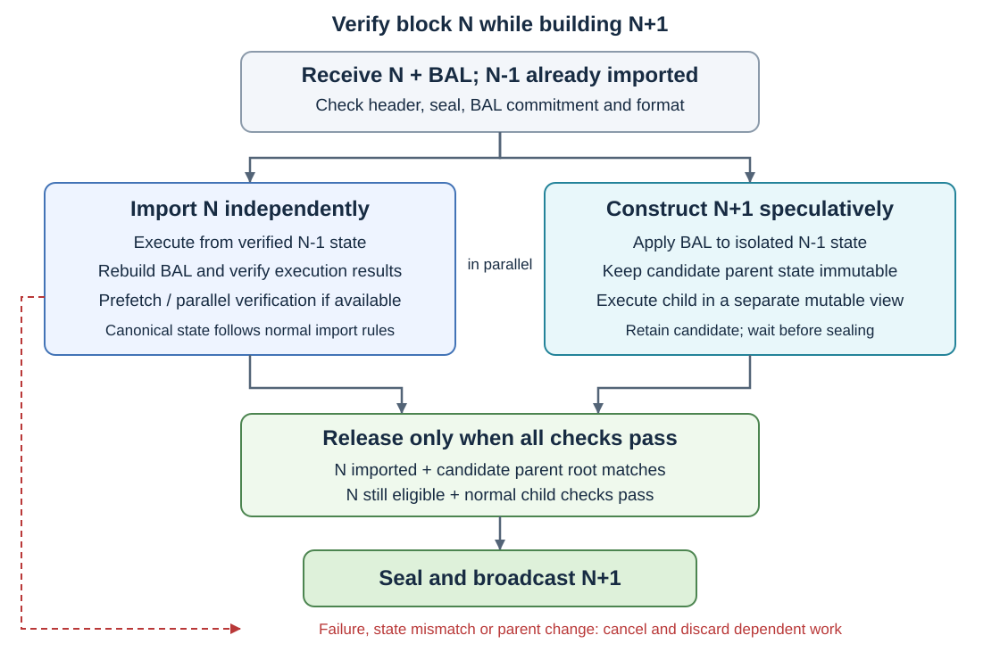

<pre>
  BEP: 732
  Title: Enable Parallel Block Production with Block Access Lists
  Status: Draft
  Type: Standards
  Created: 2026-10-28
  Description: Overlap parent block import with next-block construction using Block Access Lists.
</pre>

# BEP-732: Enable Parallel Block Production with Block Access Lists

- [BEP-732: Enable Parallel Block Production with Block Access Lists](#bep-732-enable-parallel-block-production-with-block-access-lists)
  - [1. Summary](#1-summary)
  - [2. Abstract](#2-abstract)
  - [3. Motivation](#3-motivation)
  - [4. Specification](#4-specification)
    - [4.1 Scope and Prerequisites](#41-scope-and-prerequisites)
    - [4.2 Concurrent Block Import and Local Mining](#42-concurrent-block-import-and-local-mining)
      - [4.2.1 Preliminary Checks](#421-preliminary-checks)
      - [4.2.2 Candidate Parent State and State Isolation](#422-candidate-parent-state-and-state-isolation)
      - [4.2.3 Parallel Import and Construction](#423-parallel-import-and-construction)
      - [4.2.4 Completion and Sealing](#424-completion-and-sealing)
      - [4.2.5 Failure, Reorganization and Fallback](#425-failure-reorganization-and-fallback)
    - [4.3 Supporting Bid Integration](#43-supporting-bid-integration)
    - [4.4 Supporting BidBlock Protocol Changes](#44-supporting-bidblock-protocol-changes)
      - [4.4.1 BidBlock Structure and Signature](#441-bidblock-structure-and-signature)
      - [4.4.2 Submission and Validation](#442-submission-and-validation)
      - [4.4.3 gRPC Transport](#443-grpc-transport)
    - [4.5 Integration Checklist](#45-integration-checklist)
  - [5. Rationale](#5-rationale)
  - [6. Backward Compatibility](#6-backward-compatibility)
  - [7. Security Considerations](#7-security-considerations)
  - [8. Performance Analysis](#8-performance-analysis)
  - [9. License](#9-license)

## 1. Summary

This BEP allows a validator to start building the next block while verifying its parent, giving block production more time within the existing block interval.

## 2. Abstract

A validator normally imports a received parent block before its miner starts constructing the next block. A Block Access List (BAL, [EIP-7928](https://eips.ethereum.org/EIPS/eip-7928)) records state accesses and post-transaction changes, allowing the validator to prepare a candidate parent state without waiting for parent execution to finish. This BEP uses that state to overlap import of block `N` with local construction of block `N+1`. Import independently verifies `N`, while construction runs against isolated state. The validator may seal `N+1` only after `N` has been successfully imported, the candidate parent state agrees with the verified state, and `N` remains an eligible parent. Failed verification or a parent change cancels dependent construction.

Builders can adopt the same scheduling on both the Bid (`SendBid`) and BidBlock (`SendBidBlock`, [BEP-675](./BEP-675.md)) paths, constructing candidates while verifying their parent and submitting only after parent verification succeeds. On `SendBid`, the validator generates the complete BAL during bid simulation and finalization; on `SendBidBlock`, the builder supplies it in the extended `BidBlock` as a supporting protocol change. BAL generation and propagation are integration prerequisites; the main proposal is the concurrency between parent import and next-block construction.

## 3. Motivation

As the gas limit increases, importing a received parent consumes more of the time available for transaction packing. At validator handover, a locally mining validator must first execute the outgoing validator's block and then execute its own candidate. The two operations form a sequential critical path even though the parent's BAL can already describe the state needed to start construction.

Overlapping these operations expands the building window without changing the block interval. BAL-driven prefetching and parallel verification can further reduce import latency, but the scheduling improvement also applies when parent verification uses sequential execution. It benefits local block production directly and can improve the MEV pipeline when builders adopt the same approach. On the BEP-675 path, it complements the removal of validator-side bid simulation.

## 4. Specification

### 4.1 Scope and Prerequisites

This BEP assumes the BSC adoption of EIP-7928: a complete BAL with post-transaction values, canonical RLP encoding, ordering and index rules, resource constraints, and a header commitment `BlockAccessListHash = keccak256(rlp(BAL))`. The Parlia seal must cover that commitment. The adopted rules must cover Parlia system transactions and all protocol-level state changes, including finalization and upgrade-block changes.

The optional, access-only BAL of [BEP-592](./BEP-592.md) is insufficient for reconstructing a candidate parent state. Its entries do not supply the post-state values required by this proposal.

The specification below defines concurrent import and local mining, together with supporting `SendBid` integration and the `BidBlock` extension. It relies on the BSC EIP-7928 integration for the BAL format, consensus validation and block transport, rather than defining a separate BAL protocol. The prerequisite integration work is listed in [Section 4.5](#45-integration-checklist).

### 4.2 Concurrent Block Import and Local Mining

Let `N` be a received block whose parent `N-1` has already been successfully imported. The validator may start constructing `N+1` before importing `N` completes, using the following procedure.



#### 4.2.1 Preliminary Checks

Before using `N`'s BAL for speculative construction, the validator must:

1. Verify that `N` extends the imported `N-1` and passes the normal preliminary header and Parlia seal checks.
2. Check that the supplied BAL is within the adopted resource limits and that `keccak256(BlockAccessList)` equals `N`'s `BlockAccessListHash`.
3. Decode the BAL and check canonical encoding, ordering, uniqueness and valid block access indices under the BSC adoption of EIP-7928.

These checks authenticate the supplied data and bound its use; they do not establish the correctness of the state changes or the validity of `N`. Checks requiring execution remain part of normal import.

#### 4.2.2 Candidate Parent State and State Isolation

Starting from the verified post-state of `N-1`, prepare an isolated candidate post-state of `N` by applying the BAL's state changes. For each changed account field or storage slot, use its final value in block access order, including protocol changes after the last transaction. Fields without changes retain their values from `N-1`; read-only entries are prefetch hints and must not be treated as writes. State application must preserve the adopted account creation, deletion, code and storage semantics.

Keep three state views separate:

- **Import state:** normal execution of `N`, starting from the verified state of `N-1`.
- **Candidate parent state:** the reconstructed post-state of `N`, kept immutable for parent-state queries and later comparison.
- **Child execution state:** a separate mutable view derived from the candidate parent state for constructing `N+1`.

The candidate and child states must not write to canonical state or to the importer's mutable state. Immutable database data and correctly keyed read caches may be shared. Track the work by `N`'s block hash so results cannot be reused for a different block at the same height.

Pass `N`'s header explicitly to the mining worker instead of deriving the parent from the current imported head. Header and ancestry lookups, including the context used by `BLOCKHASH`, must follow `N`'s actual parent chain without marking `N` imported or canonical early.

System-contract queries in Parlia `Prepare` and `Finalize` that depend on the parent state must read the candidate parent state with `N`'s header as their execution context. Execution of `N+1` uses its own header and child execution state. If the implementation cannot reproduce the complete parent state for a particular block, it must wait for normal import.

#### 4.2.3 Parallel Import and Construction

Run the following work concurrently:

- **Import `N`:** execute and validate the parent through the normal import path. The BAL may accelerate state prefetching and parallel transaction verification, but import must independently establish the execution results and rebuild the BAL from actual accesses and changes. Verify the rebuilt BAL against the header commitment and perform all existing block-validity checks, including state root, receipts root, logs bloom and gas used.
- **Construct `N+1`:** select and execute transactions against the child execution state, and finalize the candidate using the normal local mining rules. Retain the execution result and its dependency on `N`; do not seal or publish it while parent import is pending.

The import result must not rely on the speculative child's state or treat supplied BAL values as verified execution results. The parent's BAL describes `N`, so it does not by itself allow parallel execution of newly selected transactions in `N+1`.

Builders may adopt the same procedure for either `SendBid` or `SendBidBlock`, submitting only after they have verified the parent and confirmed their candidate parent state. This is an internal builder optimization and requires no additional builder API.

#### 4.2.4 Completion and Sealing

Before sealing a locally constructed `N+1`, the validator must establish that:

1. `N` has passed full validation and has been successfully imported.
2. The immutable candidate parent state's computed root equals the verified post-state root committed by `N`.
3. `N` remains an eligible parent under the current chain-selection and Parlia rules, and the validator is still permitted to produce `N+1` at the required time.
4. The child satisfies the normal block-production checks, including its exact `ParentHash`, header fields, system transactions and complete BAL commitment.

Only then may the validator seal and broadcast the child and reuse its local execution result through the normal insertion path. If construction finishes first, it waits for import; if import finishes first, construction continues. Recheck parent eligibility before sealing so a head change cannot release work built on an obsolete parent.

#### 4.2.5 Failure, Reorganization and Fallback

- **Parent validation fails:** cancel construction of `N+1` and discard its candidate state, transactions selected for that candidate, receipts and BAL recording. Release transaction-pool reservations; transactions remain eligible for future selection under the normal pool rules. Reject `N` through the normal import rules and restart from an eligible imported parent.
- **Parent changes:** if a reorganization or chain-head update makes `N` ineligible, cancel dependent work even if `N` itself is valid. Discard late results from the cancelled task.
- **Reconstructed state differs:** if `N` imports successfully but the candidate parent state's root differs, discard the speculative child and rebuild against the verified parent state. Successful import alone must not promote a child built on an inconsistent state.
- **BAL unavailable or unusable:** skip speculative construction and import normally, fetching or reconstructing the BAL as supported by the adopted protocol. A bad supplied BAL can be discarded, but normal execution must still rebuild and verify the header's BAL commitment. Fallback must never bypass that consensus check.
- **Resource limit or deadline reached:** abandon speculative work and use the ordinary import-then-build path. Do not delay parent validation to keep speculation running.

### 4.3 Supporting Bid Integration

On the Bid (`SendBid`) path, builders may use the parent block's BAL to overlap verification of `N` with construction of a bid for `N+1`, following the state-isolation, parent-state confirmation and cancellation rules in [Section 4.2](#42-concurrent-block-import-and-local-mining). The builder submits only after parent verification succeeds; failed verification or a parent change cancels dependent construction.

The `SendBid` request and signature remain unchanged, and no builder-supplied BAL is required. MEV-Sentry retains its existing forwarding and `PayBidTx` handling. The validator simulates the bid against an imported, eligible parent and continues its normal transaction selection and finalization. It generates the complete BAL for the final block during that execution, including any merged transactions, `PayBidTx` and system transactions. The BAL recording integration is tracked in [Section 4.5](#45-integration-checklist).

The validator commits and propagates the final BAL through the prerequisite BSC BAL integration. Validator-side bid simulation remains required; overlapping parent verification with builder construction does not remove that stage.

### 4.4 Supporting BidBlock Protocol Changes

#### 4.4.1 BidBlock Structure and Signature

Extend BEP-675's `BidBlock` with the complete RLP-encoded BAL. Keep the `BidBlockArgs` wrapper unchanged:

```go
type BidBlockArgs struct {
    BidBlock  *BidBlock
    Signature hexutil.Bytes
}

type BidBlock struct {
    Header          *types.Header  `json:"header"`
    Transactions    []hexutil.Bytes `json:"transactions"`
    Sidecars        BlobSidecars   `json:"sidecars,omitempty"`
    BlockAccessList hexutil.Bytes  `json:"blockAccessList,omitempty" rlp:"optional"`
}
```

The builder signs the submitted header hash, `BidBlock.Header.Hash()`, as specified in BEP-675. The signed header binds the BAL through `BlockAccessListHash`, which must equal the hash of the supplied BAL bytes, and binds the submitted transactions through `TxHash`. No separate BAL signature is introduced. `BlockAccessList` is a trailing RLP byte field after `Sidecars`; an empty BAL is encoded as `0xc0`, not omitted, when BAL is required after activation.

#### 4.4.2 Submission and Validation

The builder supplies the BAL for the complete submitted block, including unsigned system transactions, and sets `BlockAccessListHash` in the header. The BAL contains state accesses and changes rather than transaction hashes; signing system transactions does not change their execution or BAL entries. The validator therefore retains the submitted BAL while signing system transactions and recomputing `TxHash` as specified in BEP-675.

MEV-Sentry forwards the extended `BidBlock` and verifies the builder signature over the submitted header hash. Before signing system transactions, the validator recomputes the transaction root from the submitted transactions and requires it to match the submitted header's `TxHash`, as specified in BEP-675. Before sealing, it also checks BAL presence, commitment, encoding, indices and resource limits. These checks do not replace execution validation. After broadcast, the validator imports the block, rebuilds the BAL and verifies the execution results; a confirmed invalid BidBlock triggers BEP-675's existing builder-permission revocation. Missing or corrupted BAL attachment data alone does not establish block invalidity; the validator may obtain the committed BAL or rebuild it through execution.

#### 4.4.3 gRPC Transport

The gRPC `BidBlockRequest` envelope remains unchanged. Its existing `bid_block_rlp` field carries the RLP encoding of the extended `BidBlock`, including `BlockAccessList`:

```proto
message BidBlockRequest {
  bytes bid_block_rlp = 1; // RLP-encoded BidBlock, including BlockAccessList
  bytes signature = 2;
  string validator_host_name = 3;
  reserved 4 to 10;
}
```

Both transports carry the same `BidBlock` and builder signature; Sentry and validator must decode the structure and verify the header signature and BAL commitment consistently. A separate `block_access_list` protobuf field is unnecessary. Transport message limits must account for the complete block, sidecars and BAL before accepting submissions.

### 4.5 Integration Checklist

The following checklist records integration dependencies and implementation tasks; their completion must be verified during implementation.

- [ ] Verify the upstream EIP-7928 integration for BAL generation during local mining, including transaction-selection rollback and finalization. Confirm which logic is already available before adding BSC-specific changes.
- [ ] Add and verify BAL recording during `SendBid` simulation, including merged transactions, `PayBidTx`, candidate replacement and finalization.
- [ ] Define and validate BSC recording boundaries for Parlia system transactions and direct protocol changes. System transactions use their one-based positions in the final transaction list; block-begin and block-end operations follow the adopted pre- and post-execution index rules. Include upgrade-block changes and ensure recording and reconstruction agree.
- [ ] Integrate the BAL header commitment and Parlia seal coverage under the BSC EIP-7928 activation rules. Producers must commit the complete final BAL, and importers must rebuild and verify it.
- [ ] Ensure sealed blocks and their BALs reach validators and builders together through the [Enhanced Validator Network](./BEP-563.md), with negotiated peer support and a retrieval or reconstruction path when a BAL is missing. Use the BSC BAL transport integration rather than defining a new P2P message in this BEP.
- [ ] Implement the local import/miner scheduling, isolated state views, completion gate and cancellation rules of Section 4.2. Verify handover, parent failure, head changes, state mismatch and fallback behavior.
- [ ] Update builder, MEV-Sentry and validator codecs and signature verification for the extended `BidBlock` on JSON-RPC and gRPC. Coordinate rollout and confirm transport size limits.

## 5. Rationale

**Focus on import/miner concurrency.** BAL generation and faster parent verification are useful prerequisites, but they do not themselves remove the dependency between import and mining. A separate candidate parent state lets the miner begin useful work while the importer independently verifies that state. This is the central scheduling change, whether the next block is assembled locally or by a builder.

**Keep verification as a release condition.** The BAL commitment authenticates data supplied by the producer; it does not prove execution correctness. Isolating speculative state and waiting for successful parent import preserves the existing validity requirements while allowing construction to start earlier.

**Carry BAL inside `BidBlock`.** The BAL belongs to the block candidate, consistent with the block structure used by the BSC BAL integration. Including it in `BidBlock` gives JSON-RPC and gRPC a single representation. The signed header binds its bytes through the BAL commitment, following BEP-675's signature definition.

## 6. Backward Compatibility

Concurrent import and mining is an optional client optimization once the required BAL support is active. A client may continue to import the parent before starting construction without changing block validity. The optimization does not independently change transaction execution, the block interval or validator eligibility.

The prerequisite BSC adoption of EIP-7928 requires a hard fork for the header commitment and its inclusion in the Parlia seal. This BEP depends on that activation and does not assign a separate fork timestamp. Pre-fork blocks retain their existing rules and cannot use this reconstruction path without a suitable committed BAL.

The extended `BidBlock` adds a trailing RLP field, while the protobuf envelope is unchanged. Upgraded decoders accept pre-fork envelopes by treating that field as optional; older decoders cannot consume the extended envelope. Builders, MEV-Sentry and validators must upgrade before using it. The builder continues to sign the submitted header hash; from activation, that header commits to the complete BAL, which is required for `SendBidBlock` submissions. Local production and the unchanged `SendBid` API remain available as fallback paths, with BAL generation required by the activated consensus rules.

## 7. Security Considerations

- **Untrusted parent state:** preliminary BAL checks do not prove the state transition. Parent import must independently verify all execution results and the rebuilt BAL commitment before a dependent child is released.
- **State contamination:** speculative changes must remain outside canonical state and the importer's mutable state. A mismatching reconstructed state invalidates the speculative work even when the parent itself is valid.
- **Reorganizations and stale tasks:** construction and completion callbacks must retain the exact parent hash. A cancelled task must not later seal or publish its result after another parent is selected.
- **Resource use:** bound BAL decoding, prefetching, speculative memory and execution workers. Parent validation takes priority when CPU, storage bandwidth or memory contention would otherwise threaten progress. The procedure starts from an imported `N-1`, avoiding an unbounded chain of unverified parent states.
- **Invalid BidBlocks:** retaining the pre-seal BAL checks and BEP-675's post-broadcast validation and revocation preserves that path's existing safeguards. This proposal does not make a builder-supplied BAL proof of block validity.

## 8. Performance Analysis

The main benefit is at validator handover, when a received parent still needs import. Consecutive locally executed blocks already have reusable parent state, so the same import-wait reduction should not be assumed for them.

Let `T_import` be the baseline parent import time, `T_verify` the parent import time with the available BAL accelerations, `T_apply` the time to check the BAL and prepare the candidate parent state, and `T_build` the time to execute and finalize the same next-block workload. The local completion times are:

```text
Before:    T_import + T_build + overhead
With BAL:  max(T_verify, T_apply + T_build) + overhead_BAL
```

The `max` term retains the parent-verification gate: construction finishing first does not permit early sealing. Even if `T_verify` equals `T_import`, the two execution passes can overlap. BAL prefetching and parallel verification can further reduce `T_verify`.

For illustration, if parent import takes 100 ms, state preparation takes 10 ms and child construction takes 150 ms, the modeled completion time falls from 250 ms to 160 ms before other overhead. This is a scheduling example, not a benchmark; contention, state-root calculation, BAL encoding and cancellation costs must be measured on the target implementation.

On the BEP-675 BidBlock path, reuse its model with gas limit `G`, EVM throughput `R` and parent-verification speedup `s`:

```text
BEP-675:   2 * (G / R) + overhead
With BAL:  max(G / (s * R), T_apply + G / R) + overhead_BAL
```

When verification fits within construction and state preparation is small, the theoretical gas-limit ceiling can approach twice that of the sequential BEP-675 model. This is an upper-bound estimate under the model's assumptions, not a proposed gas-limit increase or a measured throughput claim. On `SendBid`, validator simulation remains an additional stage, so that single-pass estimate does not apply.

## 9. License

This document is licensed under [CC0](https://creativecommons.org/publicdomain/zero/1.0/).
